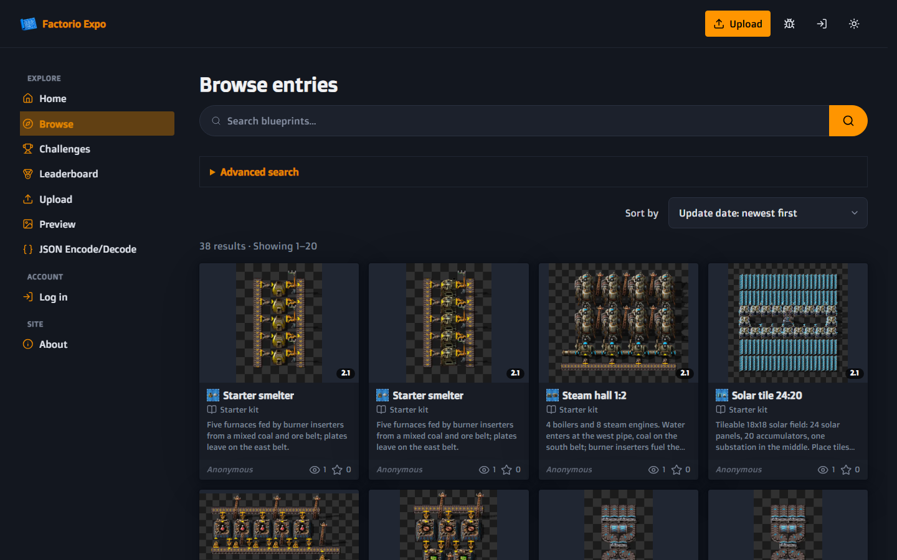
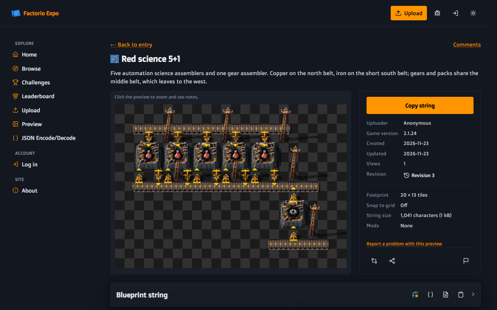
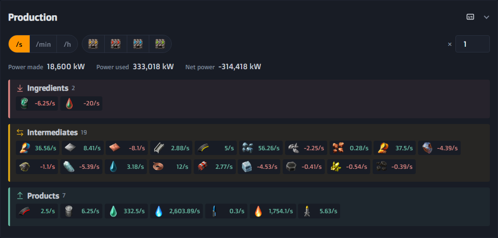
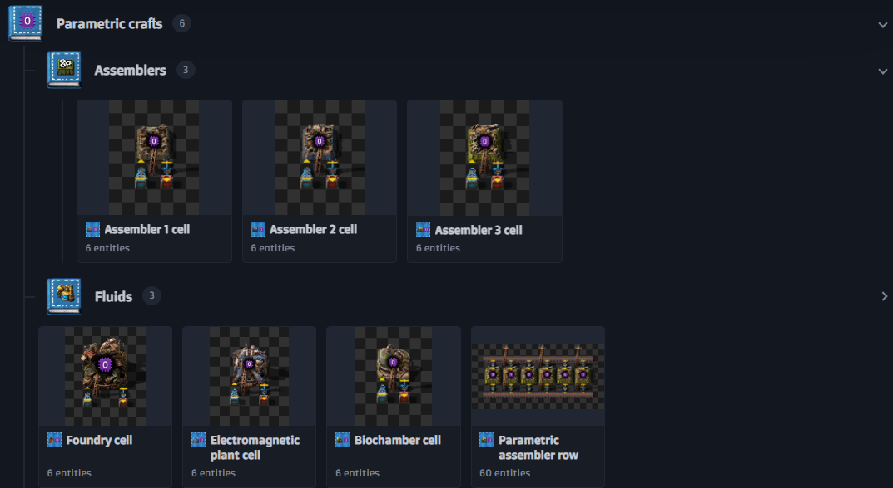
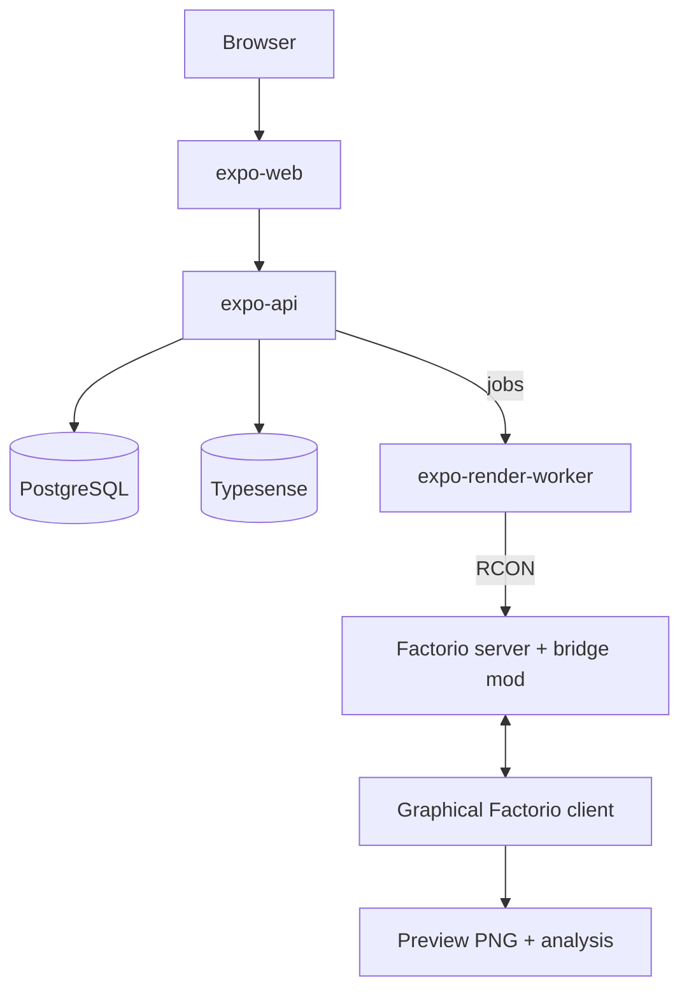

# Factorio Expo

**Share a Factorio blueprint with one link, and let the game itself show what it
does.**

Paste a blueprint string and Expo gives it a public page: a preview rendered by
real Factorio, the production rates, power and pollution worked out by the
game, the build cost, the footprint and, for space platforms, weight, thrust and
top speed. Blueprint books open as a browsable tree where every blueprint gets
its own page. Then anyone can find it by what it makes, not just by its title.



## What you can do

### Upload without an account

Paste, add a title and tags, done. Anonymous uploads get an edit link that is
the only key to change them later. An account adds favorites, collections,
private and unlisted entries, comments, and lets you claim an anonymous entry
you hold the edit link for. Not sure yet? A **quick preview** renders a
blueprint without publishing it and expires after a day.

### See it as the game sees it

Every blueprint is placed on a clean surface inside a headless Factorio server
and captured by a graphical client, so the preview is the game's own render,
quality badges, elevated rails and all. The page follows the render live, and
the preview opens full size, pixel for pixel.



### Numbers you can trust

The analysis runs inside the game against the placed entities, so modules,
beacons, quality and recipes count exactly as Factorio counts them:

- ingredients, intermediates and products per second, per minute or in belts
- electricity and pollution
- build cost in items and in raw resources
- footprint and snap-to-grid
- space platform weight, thrust and theoretical top speed



### Books, planners and revisions

Books keep their structure, labels, icons and order; every blueprint inside
gets its own preview and analysis, and a book shows partial results while the
rest renders. Upgrade and deconstruction planners are listed with their
settings. Uploading a new version adds a revision, and every earlier revision
stays available exactly as it was uploaded.



### Search by what a blueprint does

Text and icon search, curated tags, and filters on the analysed facts: "makes
at least 1 legendary quantum processor per second", "fits in 50x50",
"platforms faster than 200 km/s", "vanilla only", entities and recipes at a
given quality, game version. Expo also detects which mods a blueprint needs and
suggests tags from what is in it.

### Everything else

- Comments on public entries, with `#N` references and icon tokens
- Favorites, public or private collections and public profiles
- Reporting entries and comments, handled by a staff console with bans and an
  audit log
- A JSON encode/decode tool, raw string links for other sites, and one click to
  open a blueprint in the Factorio Blueprint Editor
- No ads, no tracking: page views are counted without storing personal data

## How it works



- **expo-api** (Go) owns all product data and decodes every upload, books
  included, before anything is queued.
- **expo-render-worker** (Go) queues one job per blueprint and drives Factorio
  over RCON, one blueprint at a time, healing on its own when the game crashes.
- **factorio-expo-bridge** (a Lua mod) places the blueprint, runs the analysis
  (adapted from [Rate Calculator](https://codeberg.org/raiguard/RateCalculator))
  and has the client capture the preview.
- **expo-web** (Astro and Svelte) renders every page on the server.

Details in [docs/architecture.md](docs/architecture.md).

## Run it yourself

You need Docker and your own Factorio account that owns Space Age: the game
is not part of this repository, it is downloaded for you with your account's
username and token (`FACTORIO_USERNAME`, `FACTORIO_TOKEN`), and the previews,
analysis and icon sheets are generated from it on your machine.

1. Copy `.env.example` to `.env` and fill in at least `FACTORIO_USERNAME`,
   `FACTORIO_TOKEN`, `FACTORIO_RCON_PASSWORD`, `POSTGRES_PASSWORD`,
   `API_POSTGRES_PASSWORD`, `RUNNER_POSTGRES_PASSWORD`, `API_JWT_SECRET`,
   `API_IP_HASH_SECRET` and `ADMIN_API_TOKEN` (`openssl rand -hex 32`).
2. Start the stack. `expo-db-setup` creates the database roles and applies the
   migrations before the API and render worker start:

   ```sh
   docker compose up --build
   ```

3. Open http://localhost:3000. The API is on http://localhost:8080 and Postgres
   on `127.0.0.1:5432` for local inspection.
4. Optional: the staff console and monitoring (the `admin` profile; set
   `ADMIN_DEV_USER` in `.env` to sign in locally, see
   [docs/admin.md](docs/admin.md#running-it)):

   ```sh
   docker compose --profile admin up -d --build
   ```

   then open http://localhost:3200.

## Development

- Go: `go build ./... && go test ./...` from the repo root.
- Database-backed tests run when `TEST_DATABASE_URL` points to a database with
  the migrations applied:

  ```sh
  docker run -d --rm --name fx-test-pg -e POSTGRES_PASSWORD=pw -e POSTGRES_DB=fx \
    -p 55432:5432 postgres:18.6-alpine3.24
  docker exec -i fx-test-pg psql -U postgres -d fx -q < apps/expo-api/migrations/000001_init.up.sql
  docker exec -i fx-test-pg psql -U postgres -d fx -q < apps/expo-api/migrations/000002_seed_initial_data.up.sql
  TEST_DATABASE_URL="postgres://postgres:pw@localhost:55432/fx?sslmode=disable" go test -p 1 ./...
  ```

  `TestLiveTypesenseSearch` (community names, text scoping, date range, facet
  counts, similar blueprints) runs against a real Typesense when
  `TEST_TYPESENSE_URL` and `TEST_TYPESENSE_API_KEY` are set, e.g. after
  `docker run -d --rm -p 18108:8108 typesense/typesense:30.2 --data-dir /tmp --api-key=devkey`
  (`TEST_TYPESENSE_URL=http://localhost:18108`); it uses a collection version of
  its own and drops it.

  Runner store/handler tests need `TEST_RUNNER_DATABASE_URL`: a separate
  database with `apps/expo-render-worker/migrations/` applied. Use `-p 1`:
  packages sharing one database truncate each other's tables. Connect tests as
  an admin role; some tests truncate or alter tables.

- Lua bridge tests run inside `go test ./apps/expo-render-worker/internal/bridge/`
  when `lua` is on the PATH.
- JavaScript workspace (Node 26+): `pnpm install` at the repository root installs
  expo-web, expo-admin, packages/expo-ui and e2e. Shared dependency versions are
  the `catalog:` in `pnpm-workspace.yaml`; oxlint/oxfmt and their configs live at
  the root. `pnpm lint:check`, `pnpm format:check`, `pnpm test` and `pnpm build`
  at the root cover every package (each package also has its own scripts).
- Git hooks ([lefthook](https://lefthook.dev), `lefthook.yml`), installed by
  `pnpm install`: pre-commit checks staged Go files with gofmt and `go vet ./...`
  and staged JS/TS files with oxfmt and oxlint; commit-msg enforces
  [Conventional Commits](https://www.conventionalcommits.org) (commitlint);
  pre-push refuses pushes to `master`. `LEFTHOOK=0` skips them once.
- Web: `cd apps/expo-web && pnpm dev`.
- End-to-end: `cd e2e && pnpm exec playwright install chromium && pnpm test`
  builds a separate, throwaway compose stack (no Factorio, own database) and runs
  the Playwright suite against it. See [docs/e2e.md](docs/e2e.md).
- Migrations by hand (asks database, then up/down/force):

  ```sh
  docker compose run --rm expo-db-migrate
  ```

- Start over with empty databases (keeps the Factorio download): `docker compose down`,
  then `docker volume rm factorio-expo_postgres-data factorio-expo_typesense-data
  factorio-expo_render-worker-data factorio-expo_factorio-preview-inbox`, and
  clear the `EXPO_STORAGE_DIR` contents. `docker compose up -d --build` recreates everything.

## Where to look

| Path | What |
|---|---|
| `apps/expo-api` | public API, catalog and the staff API |
| `apps/expo-web` | the website |
| `apps/expo-admin` | the staff console (behind an identity-aware proxy) and monitoring |
| `apps/expo-render-worker` | preview and analysis worker |
| `apps/expo-db` | database roles and migrations (`expo-db-setup`, `expo-db-migrate`) |
| `apps/expo-game-data` | game data generator: icon sheets and the mod name table |
| `factorio/` | bridge mod and Factorio images |
| `e2e/` | Playwright end-to-end tests |
| `docs/` | design docs: start with the [code map](docs/code-map.md) and [architecture](docs/architecture.md) |

Contributors and coding agents: see [AGENTS.md](AGENTS.md).

## Built with AI

This project was created with the help of AI coding tools. Contributions are
welcome, and using AI tools to make them is fine: you are responsible for what
you submit, so read, run and test it first. [AGENTS.md](AGENTS.md) gives coding
agents the project rules.

## Legal

The code in this repository is released under the [MIT License](LICENSE). The
licence covers the code only. It does **not** cover:

- Factorio itself, its graphics, icons, prototype data and the previews
  rendered from it. They belong to Wube Software and are not in the
  repository: you generate them locally from a game you own.
- Mods and their graphics, which keep their own licences (Expo does not ship
  modset icons).
- Blueprints that users upload to a running site, which stay under their
  authors' rights and the site's terms of use.

Factorio Expo is an unofficial fan project, not affiliated with or endorsed by
Wube Software. Factorio is a trademark of Wube Software; the previews, icons and
game data come from the game and belong to them.
The bridge's analysis code is adapted from Rate Calculator (MIT, see
[THIRD_PARTY_NOTICES.md](factorio/factorio-expo-bridge/THIRD_PARTY_NOTICES.md)).
