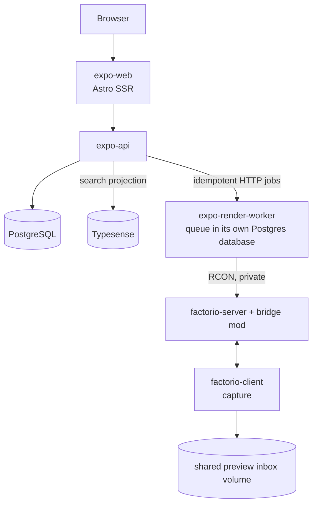

# Architecture

Factorio Expo hosts Factorio blueprints, renders previews and analyses them
inside real Factorio. Uploads are anonymous and public by default.

## System

Compose services: `factorio-downloader`, `factorio-server`, `factorio-client`,
`expo-render-worker`, `expo-postgres`, `expo-typesense`, `expo-api`,
`expo-web`, one-shot `expo-db-setup` and `expo-storage-init`; profile `tools`:
`expo-game-data`, `expo-db-migrate`; profile `admin`: expo-admin, Dozzle and
its socket proxy ([admin.md](admin.md#running-it)). One process per service;
nothing is built for multiple nodes. Compose publishes RCON, Postgres, the API
and web on loopback only; a reverse proxy in front routes to expo-web and
expo-api.

## Ownership

| Concern | Owner | Storage |
|---|---|---|
| Users, entries, revisions, books/blueprints, tags, favorites, collections, previews metadata, analysis snapshots, dispatch intents | API | PostgreSQL (catalog database) |
| Preview images (WebP) | API | file storage (`internal/storage`, bind mount) |
| Search documents | API | Typesense (rebuildable) |
| Queue, leases, phase state, temporary artifacts | Runner | `runner_*` tables in its own database + artifact dir |
| RCON, bridge protocol, capture, artifact validation | Runner | none |
| Placement and Factorio-authoritative calculation | Bridge mod | none |

Each app owns its database and migrations; `expo-db-setup` applies both, and
each app's role cannot reach the other database ([database.md](database.md)).
Services exchange versioned, idempotent HTTP messages (`internal/runnerapi`).

## Identity and editing

- Canonical link `/e/{id}` (`internal/shortid`). Signed-in owners may add a
  vanity alias `/@{username}/{slug}` (canonical stays `/e/{id}`; no history or
  redirect).
- Anonymous entries: `owner_user_id` null and an edit token stored only as
  SHA-256. A lost token means no further edits. Publishing with the token
  while signed in claims the entry.
- Imports: the API fetches a link to a supported site (`internal/importer`)
  and the string goes through the normal creation path; the entry keeps
  `source_url`.
- `revisions.game_version` is read from the exchange string; no content-set
  version is stored.

## Submission and preview pipeline

1. `POST /api/v1/entries` decodes and walks the whole submission within
   `blueprint.DefaultLimits`.
2. One transaction stores entry, revision (original string, shape tree),
   every book/blueprint/planner row, tags, and the intents: a `phase_jobs`
   preview and analysis row per leaf (placed in the
   [render queue](#render-queue)) and an `entry_search_jobs` row. Leaves whose
   string already has a result take it ([result reuse](#result-reuse)); the
   rest must fit the uploader's cap or the whole upload is refused (429).
3. `preview.Dispatcher` (on `internal/outbox`: claim with
   `FOR UPDATE SKIP LOCKED` and a lease, woken by `Nudge` after commit) sends
   one idempotent runner job per leaf, in queue order, while the runner holds
   fewer than the dispatch window. The API owns retries: each phase up to 3
   times with doubling backoff (5 s, cap 5 min), a new runner job each time,
   only for failures the runner flags `retryable` (plus lost jobs, missing
   artifacts, transport errors). A reconcile task recreates missing intents
   every minute.
4. The runner runs jobs FIFO with one worker, each once
   (`RUNNER_CAPTURE_TIMEOUT`, 5 min), claiming only while the bridge is ready
   (compatible protocol, idle, client connected), so a Factorio restart
   delays jobs instead of failing them. A restart during a job is
   `factorio_restarted` (final: the blueprint almost always crashed the
   server); a client that died after capture is `result_missing`
   (retryable). The `factorio-client` watchdog restarts a client that left
   the game. The bridge is driven over RCON with bounded chunked uploads
   ([bridge-protocol.md](bridge-protocol.md)).
5. The bridge builds a fresh surface, places and revives ghosts in tiers,
   strips snap-to-grid, runs the analysis, and has the client capture.
6. Preview and analysis are separate atomic result files. The runner
   validates what it ingests (marker schema, job id, PNG structure and limits,
   render profile, analysis via `internal/analysisresult`).
7. The API imports each phase when ready (preview into file storage,
   analysis into `blueprint_stats`) through the catalog, which queues the
   search sync in the same transaction, then releases the runner's copy.
8. Settled phases go to `progress.Hub` (in-process; one API process) and out
   on the entry's SSE stream. The hub only wakes streams: they re-read
   PostgreSQL every 30 s, so a missed signal delays an update instead of
   losing it.

Book state is derived from its leaves and shows partial success.

## Render queue

One Factorio pair renders everything, so the API decides the order
(`internal/renderqueue`, `ClaimDispatchJobs`). The runner never holds more
than `API_RENDER_WINDOW` (2) unfinished jobs: one rendering, one ready.

- **Key:** `u:<user>`, `ip:<HMAC of address>`, `staff` or `system`.
- **Place:** `order_at` = queued time + the kind's delay, one key's leaves
  spaced `API_RENDER_LEAF_GAP` (30 s) apart after its last waiting leaf. Lowest
  first. So a 100-leaf book interleaves with everyone else's work but still
  runs at full speed when nobody waits; places are times, so nothing starves.

| Work | Delay | Spaced |
|---|---|---|
| Quick preview, staff re-run | 0 | no |
| Signed-in upload/revision | 30 s | yes |
| Anonymous upload/revision | 2 min | yes |
| Re-render of an evicted full preview | requester's delay + 1 min | yes |
| Repaired lost intent | 2 min | no |

- **Cap:** at most 100 waiting leaves per address, 300 per account (live
  entries, pending phases). A submission that would pass it is refused whole
  (429 `render_queue_full`), checked in the upload transaction under the key's
  lock. Staff re-runs have no cap.
- Identical strings already in the runner are not sent twice.
- No global budget anywhere; a distributed flood is the
  [emergency switches'](admin.md#settings) job. All defaults are env
  (`API_RENDER_*`) and guesses until measured.

## Result reuse

A leaf whose exact string another leaf already has (any entry, deleted ones
too) takes that leaf's result instead of rendering (`catalog/reuse.go`;
`blueprints.exchange_sha256` finds candidates, strings confirm). Copied: the
`previews` row (only when its full file is stored; source row locked
`FOR SHARE` until commit so the sweep cannot race), a current analysis, and
final failures that are the blueprint's own (`invalid_blueprint`,
`blueprint_too_large`, `request_too_large`, `analysis_failed`,
`factorio_restarted`), so a string that crashed the server cannot crash it
again. Not copied: `invalid_result`, `result_mismatch`, retryable failures.
Runs on upload and before every dispatcher claim (`ReuseWaitingResults`).

## Blueprint string tools and tag suggestions

The backend does all decoding (`decode`, `encode`, `inspect`): mod detection
needs name tables too big for browsers, and search needs the same results
server-side. Inspect is a convenience; an upload works without it.

Tag suggestions come from inspect, without analysis. Rules are
`tag_suggestion_rules` rows (seeded, edited in the console; the catalog
reloads them on change): a tag, an entity/recipe/quality name, count range and
points. Tags below `API_TAG_SUGGESTION_MIN_SCORE` (2) are dropped; each group
keeps its best 3, then the best 8 overall plus ties. Only tags that names in
the string can prove get rules (no layout or purpose tags). Nothing is ticked
without a click.

## Preview files

Each preview is two immutable files named by the PNG's SHA-256
(`previews/ab/<sha>.webp` and `.thumb.webp`), encoded once at import by the
`cwebp` binary (`-q 80 -m 6 -sharp_yuv`; built statically in the API image,
checked at startup). The thumbnail fits 800x800 px; a preview that already
fits is stored as the thumbnail alone. No fallback format.

- **Why lossy WebP q80 + sharp YUV:** previews are ground texture and dense
  sprites that no lossless codec shrinks (lossless WebP 77 MB vs 18 MB for the
  47 test previews at 34.7 dB PSNR). Sharp YUV stops reds and yellows
  bleeding. Lossy JPEG XL saves little and still needs a fallback; pure-Go
  encoders were larger or lack sharp YUV.
- **Import** (`preview/importer.go`): background, at most
  `API_PREVIEW_ENCODERS` at once; SHA-256 check against the artifact; files
  written and the `previews` row created under one in-process lock that the
  file sweep also takes.
- **Deletion:** a deleted or replaced `previews` row queues its source in
  `preview_file_deletions` (trigger); the minute sweep deletes unreferenced
  files.
- **Serving:** `public, max-age=86400` with ETag for public and unlisted,
  `private, no-store` for private. Storage keys are never public.
- **Storage budget** (`preview/budget.go`): only full files are evicted,
  oldest written first, when usage passes 90% of `API_STORAGE_MAX_BYTES` or
  free disk drops below `API_STORAGE_MIN_FREE_BYTES`, down to 80%. Thumbnails
  always stay. An evicted full file is re-rendered on demand when the zoom
  modal opens it, as the visitor's work in the render queue.
- **Re-runs:** one entry point, `preview.Requeuer.Requeue`, then the normal
  path. The phase rule keeps a stored result `ready` even if a re-run fails.
  Callers: the evicted-preview re-render and staff re-runs.

Exchange strings stay in PostgreSQL (same disk either way, same transaction).

## Quick previews and expiry

A quick preview is an ordinary entry with `quick_preview` and `expires_at`
(`API_QUICK_PREVIEW_TTL`, 24 h), so it reuses the whole pipeline. Single
blueprints only; never indexed or listed; read-only (409) until published;
hard-deleted when a phase fails for good (`RejectQuickPreview`) or when it
expires. Publishing (owner, or a signed-in edit-token holder) sets details,
owner and expiry and clears the flag; nothing re-renders. Regular anonymous
entries are claimed the same way.

Uploads may expire after 1/7/14/30 days. Expired entries read as missing; the
`expired_entries` task (every minute) hard-deletes expired quick previews and
soft-deletes other expired entries with their search removal.

## Page views

Only page views count: the entry and leaf pages send one `sendBeacon` once
shown (not editors, quick previews or private entries). `internal/views`
counts one view per visitor per entry per UTC day from in-memory hashes of
address + user agent + entry under a daily key (no personal data stored; bots
skipped). Flushed every `API_VIEW_FLUSH_INTERVAL` to `entry_view_counts` and
`entry_view_days` (trending); view counts reach search as partial updates
every `API_SEARCH_VIEW_INTERVAL`.

## Leaderboards, XP and badges

Leaderboards are ranked in the API from `blueprint_stats.production` (a small
candidate set via a partial index), not Typesense. Rules:
[api.md](api.md#profiles-leaderboards-challenges).

XP is an append-only ledger (`xp_events`, `catalog/xp.go`,
`xpledger.go`): each row names its source event (`source_key`, unique), so
nothing is awarded twice. Awards are written in the same transaction as the
event (no outbox); records and challenge awards come from idempotent tasks.
Anonymous entries, self-favorites, deleted or banned accounts earn nothing.
Daily caps count every row of the UTC day under an advisory lock. Removed
content stops counting without touching the ledger (totals count rows whose
entry is live). Levels, points and badges are constants served by
`GET /api/v1/xp-rules`. No ranking of users; XP never reaches search.

## Game data tool

`apps/expo-game-data` (compose `tools` profile) is the one source of game
graphics and data: it runs Factorio `--dump-data` for base, built-in mods and
each modset in `modsets.json`, and writes the WebP sprite sheets
(`packages/expo-ui/game-icons/`), the TypeScript lookup tables
(`packages/expo-ui/src/game/data/`) and the mod name table
(`apps/expo-api/internal/mods/modsets.json`). Re-run after upgrading the
pinned game or the modset list, then rebuild the API and web. See its README.

## 2.1 compatibility

Factorio 2.1 splits an entity's input and output wire networks. For leaves
from before 2.1 the API judges structurally (`blueprint.Compat21`) with the
[2.1 Circuit Audit mod](https://github.com/ipost/factorio-mod-2.1-circuit-audit)'s
rule: flagged when a control behaviour has an input flag and an output flag
set. The verdict means "may be affected". Stored on `blueprints.compat_21` and
`revisions.compat_21` (worst leaf); shown as the card badge
(`apps/expo-web/src/lib/version-badge.ts`), on the leaf page and as the
`v2.1-compatible` search option.

## Mod detection

`internal/mods` labels a blueprint with the mods its entity and recipe names
need. It never rejects an upload and never changes what is rendered (the
pinned content set; the bridge strips unknown names). Built-in mods are exact;
other modsets are scored by the share of non-vanilla names they define;
unmatched names are "unknown". Stored per leaf with the table version; the API
re-detects older leaves at startup and reindexes them. Cards show Space Age
plus modsets scoring at least 0.5; search filters on it.

## Security and operations

- Only the render worker reaches RCON, the bridge and the inbox volume. Raw
  RCON and container control are never public; runner job ids are never
  public ids.
- A run that ended without an outcome (crash, lease expiry, restart) is failed
  as `interrupted` (retryable) at the next claim. Runner artifacts have a
  TTL; the worker removes a job's inbox when it ends.
- The runner API is versioned by path (`/v1`); the bridge carries
  `protocol_version`, and a mismatch makes readiness report `incompatible`.
- Export rules: keep exact original strings; book strings are re-encoded from
  leaves on demand.
